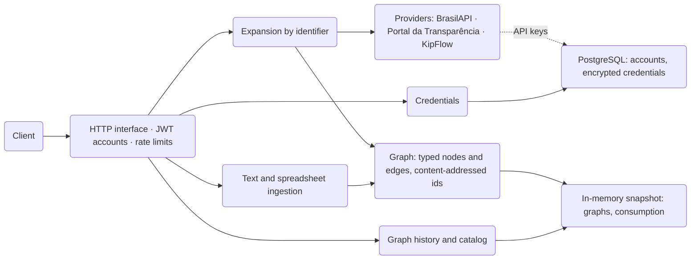

# OSINT Engine

[](https://github.com/geldois/osint-engine/actions)
[](https://github.com/geldois/osint-engine/releases)
[](https://www.python.org)
[](LICENSE)

Entity relationship graph engine that expands identifiers into a fully traceable network of connections sourced
exclusively from official public records.

**Live:** [osint-engine.duckdns.org/docs](https://osint-engine.duckdns.org/docs)

## Overview

A **CNPJ** enters the engine as a root identifier. The engine queries official public records, constructs a typed
immutable graph, and returns it — ready to traverse. Each **Node** represents a real-world entity: a company, a person,
an address, a CNAE classification, a phone, an email, a sanction record, an ingested text source, a legal process, or a
political-exposure record. Each **Edge** names the relationship between two nodes: `company_has_member`,
`person_owns_company`, `company_located_at`, and so on. Relationships that read naturally from both ends exist in both
directions — `company_located_at` and `address_hosts_company` — and every graph already carries both.

Every node and edge carries a stable, deterministic identity derived exclusively from its content. The same CNPJ
expanded on different machines at different times always produces the same graph with the same IDs — making the
structure idempotent by construction, not by convention.

## Architecture



## API

Every endpoint except `/auth/register`, `/auth/token` and the two health endpoints requires a Bearer token. There is no
seeded account and no anonymous access: create your own account first, then use its token on every subsequent request.

### Authentication

```http
POST /auth/register
Content-Type: application/json

{ "username": "alice", "password": "<at least 8 characters>" }
```

Creates the account and answers `201` with a token, same response shape as below. `username` is 3 to 32 characters of
lowercase letters, digits, `_` or `-`; `password` is 8 to 128 characters; anything else is `422`. A username already in
use is `409`. Signup is open and limited to 10 per 15 min per client IP. Accounts and their password hashes are stored
in PostgreSQL, so they survive a restart.

```http
POST /auth/token
Content-Type: application/x-www-form-urlencoded

username=alice&password=<your password>
```

Returns a token with a 60-minute TTL (`ACCESS_TOKEN_EXPIRE_MINUTES`):

```json
{ "access_token": "<token>", "token_type": "bearer" }
```

Every account is equal: what a caller can use depends on which provider keys they saved with `POST /credentials`, never
on a privilege level. `/cnpj/{cnpj}` and the history routes need no key; the CPF, legal-process and Portal da
Transparência routes answer `404` until the caller has saved the matching provider key.

### Provenance on every graph response

Every endpoint returning a `GraphSchema` — expansion, text ingestion, and graph history alike — carries provenance
alongside the data. The graph itself, and every node and edge inside it, each carry a `content_id` (a UUID5 over the
entity's full content, distinct from the `id` derived only from its identity fields) and a `revision` object:

```json
{ "fetched_at": "2026-08-21T03:11:59.728122Z", "merged_at": null, "provider": "brasilapi" }
```

`content_id` is what distinguishes two observations of the same entity: the `id` is stable across every revision, the
`content_id` changes whenever the content does, and two fetches returning identical content produce the same
`content_id`. Within a single response every node and edge repeats the enclosing graph's own `revision`, since they were
all observed in that one fetch; the repetition is what lets a client merge several graphs and still know where each part
came from. `merged_at` is `null` until a revision has actually been reconciled with an earlier one.

### Graph expansion

```http
GET /cnpj/{cnpj}?force=false
Authorization: Bearer <token>
```

Returns a `GraphSchema` containing the root company, all connected entities, and all typed relationships. Needs no
provider key. The current provider is [BrasilAPI](https://brasilapi.com.br) (see `docs/architecture/infrastructure.md`).

```http
GET /cpf/{cpf}?force=false
Authorization: Bearer <token>
```

Returns a `GraphSchema` rooted at the `Person` the CPF resolves to, including `registration_status`/`registration_date`
when the provider has them. The current provider is [KipFlow](https://kipflow.io), a paid API. Requires the caller's own
saved `KIPFLOW` credential, via `POST /credentials`.

```http
GET /legal-process/{cpf_or_cnpj}?force=false
Authorization: Bearer <token>
```

Returns a `GraphSchema` rooted at the `LegalProcess` nodes tied to that identifier. Same paid-provider shape as
`/cpf/{cpf}`: the current provider is [KipFlow](https://kipflow.io), requires the caller's own saved `KIPFLOW`
credential. `/peps/{cpf}` returns political-exposure `GraphSchema`s the same way as every other Portal da
Transparência-backed route below — free, but it needs the caller's own saved `PORTAL_TRANSPARENCIA` credential.

Every graph-expansion route above, and every one of `/cnep`, `/ceis`, `/ceaf`, `/cepim`, `/peps`, `/legal-process`,
carries the same `?force=false` reuse lock, tracked per user: a repeated expansion of the same identifier on the same
route by the same user returns `409` instead of calling the provider again, unless `force=true` is passed — including a
repeat after a `204`, since an empty result is still a definitive answer from the provider. Returns `204` (empty body)
when the provider has no record for the identifier.

```http
POST /cpf/batch
Authorization: Bearer <token>
Content-Type: application/json

{ "cpfs": ["11144477735", "..."], "force": false }
```

Expands up to 50 CPFs in one request, every expansion in its own transaction — one item's failure never discards
another's paid fetch. The response carries a single `GraphSchema` union of everything that expanded (`null` when nothing
did) plus one `outcome` per deduplicated input CPF (`expanded`, `already_fetched`, `failed`, `empty` or `invalid`), in
input order, each echoing the input string verbatim. Always `200` when the batch was processed, even when every item
failed — the per-item result lives in `outcomes`, never in the HTTP status.

```http
POST /cpf/batch/estimate
Authorization: Bearer <token>
Content-Type: application/json

{ "cpfs": ["11144477735", "..."] }
```

The read-only pre-flight for a batch: sorts the deduplicated CPFs into `already_fetched`, `billable` and `invalid`, and
returns `wait_seconds` — the forecast, rounded up, for the caller's own KipFlow quota to release the billable calls,
counting anything already queued ahead. `0` when nothing is billable or the caller has no `KIPFLOW` credential saved.
`force` mirrors the batch's: with `force: true`, already-fetched CPFs count as billable, since the batch would spend
calls on them.

```http
GET /graphs
Authorization: Bearer <token>
```

Returns a `GraphCatalogSchema` — one entry per distinct root `root_id` ever fetched, each carrying
`first_fetched_at`/`last_fetched_at`, every `provider` and `fetched_routes` involved, a `revision_count`, and the root
`Node` itself. Any authenticated caller. The catalog and every history route below are shared across accounts today: a
caller sees whatever any account expanded, a known gap recorded among the interface document's open problems.

```http
GET /graphs/{root_id}/history
Authorization: Bearer <token>
```

Returns every `Graph` revision ever stored for that `root_id`, as a `GraphSchema` array ordered by `fetched_at`
ascending (oldest first). Any authenticated caller. `200 []` for a `root_id` never seen — an empty history is a valid
state, not an error.

```http
GET /nodes/{node_id}/history
Authorization: Bearer <token>
```

Returns every stored revision of that node, oldest first, as a plain array of the node's own schema — not wrapped in a
`GraphSchema`, since one node's history has no edges or root of its own. Any authenticated caller.

```http
GET /edges/{edge_id}/history
Authorization: Bearer <token>
```

Same shape as `/nodes/{node_id}/history`, for one edge's own history instead. Any authenticated caller.

```http
GET /consumption
Authorization: Bearer <token>
```

Every CPF-expansion attempt ever recorded, regardless of outcome (`already_fetched`, `empty`, `expanded`, `failed`) —
including one the reuse lock blocked before it ever reached the paid provider. Ordered by `requested_at` descending
(newest first). Only the caller's own entries are returned, since an entry names which CPF a caller looked up and when.

```http
GET /consumption/{cpf}
Authorization: Bearer <token>
```

Same shape, scoped to one CPF, ordered by `requested_at` ascending. Each entry carries `entity_id` (always present),
`entity_ref` (`id`/`content_id`, present only for `already_fetched`/`expanded`), `outcome`, `provider`, `requested_at`
and `username`. `200 []` for a CPF never attempted.

### Text ingestion

All three routes are available to any authenticated caller.

```http
GET /text-ingestion/patterns
Authorization: Bearer <token>
```

Lists every atomic pattern name (with the node type and fields it covers) plus every registered pattern set shortcut,
without exposing the underlying compiled regex.

```http
POST /text-ingestion
Authorization: Bearer <token>
Content-Type: application/json

{ "text": "...", "patterns": ["brazilian_documents_v1", "CNPJ_LOOSE"] }
```

`patterns` accepts any mix of pattern set shortcuts and individually-named atomic patterns in the same call; they
resolve to a union before matching. Extracts CPF/CNPJ/CEP-and-number from free text via regex plus a mod-11 checksum,
never calling any external API. Every match is checked against what the graph already knows by deterministic id: an
existing entity is only linked, a new one becomes a minimal stub (identity field only, nothing invented). The response
is a `GraphSchema` rooted at a `TextSource` node, with a `PersonMentionedInText`/`CompanyMentionedInText`/
`AddressMentionedInText` edge per match, each carrying the exact pattern name that produced it. Returns `422` if nothing
matched or if `patterns` names an unknown pattern set or atomic pattern. See `docs/architecture/application.md`.

```http
POST /text-ingestion/file
Authorization: Bearer <token>
Content-Type: multipart/form-data

file=<a .xlsx or .csv file>
patterns=brazilian_documents_v1
patterns=CNPJ_LOOSE
```

Same matching, stubbing, and response shape as `POST /text-ingestion` above, `patterns` accepting the same mix of
shortcuts and atomic names — only the input differs: every cell of the uploaded spreadsheet is flattened into text
verbatim (no trimming, no reformatting, numeric cells converted via plain `str()`) and fed to the same matcher. Every
sheet of a `.xlsx` workbook is scanned, not only the active one; a formula cell is read by its last computed value,
never the formula text. Rejects anything above 10 MB or 50,000 rows in a single sheet, any extension other than `.xlsx`
or `.csv`, a CSV field past the parser's own size limit, and any file whose content isn't a valid spreadsheet, all as
`422`. See `docs/architecture/infrastructure.md`.

### Credentials

All three routes are scoped to the caller's own username: one account never sees another's keys.

```http
POST /credentials
Authorization: Bearer <token>
Content-Type: application/json

{ "provider": "KIPFLOW", "api_key": "<key>" }
```

Saves the caller's API key for a provider, encrypted with `EXTERNAL_CREDENTIAL_ENCRYPTION_KEY`, and answers `204`.

```http
GET /credentials
```

Lists every provider with whether the caller has a key saved (`{"provider": ..., "configured": true|false}`), never the
key itself.

```http
GET /credentials/{provider}/reveal
```

Returns the caller's decrypted key for that provider (`{"api_key": ...}`) so the studio can show it back to its owner.

### Health

```http
GET /health
```

Liveness — always `200 {"status": "ok"}` while the process is up, touching no dependency. Both health endpoints are
unauthenticated and unthrottled so the deploy pipeline and any uptime monitor can poll them freely.

```http
GET /health/ready
```

Readiness — `200 {"status": "ready"}` when Postgres answers a `SELECT 1`, `503 {"status": "not_ready"}` otherwise.

### Rate limiting

| Endpoint                           | Limit       | Keyed by                   |
| ---------------------------------- | ----------- | -------------------------- |
| `POST /auth/token`                 | 5 / 10 min  | Client IP                  |
| `POST /auth/register`              | 10 / 15 min | Client IP                  |
| `GET /cnpj/{cnpj}`                 | 100 / min   | Shared per-route bucket    |
| `GET /cpf/{cpf}`                   | 100 / min   | Per-user, per-route bucket |
| `POST /cpf/batch`                  | 10 / min    | Per-user, per-route bucket |
| `POST /cpf/batch/estimate`         | 10 / min    | Per-user, per-route bucket |
| `GET /graphs`                      | 100 / min   | Per-user, per-route bucket |
| `GET /graphs/{root_id}/history`    | 100 / min   | Per-user, per-route bucket |
| `GET /nodes/{node_id}/history`     | 100 / min   | Per-user, per-route bucket |
| `GET /edges/{edge_id}/history`     | 100 / min   | Per-user, per-route bucket |
| `GET /consumption`                 | 100 / min   | Per-user, per-route bucket |
| `GET /consumption/{cpf}`           | 100 / min   | Per-user, per-route bucket |
| `GET /cnep/{cpf_or_cnpj}`          | 100 / min   | Per-user, per-route bucket |
| `GET /ceis/{cpf_or_cnpj}`          | 100 / min   | Per-user, per-route bucket |
| `GET /cepim/{cnpj}`                | 100 / min   | Per-user, per-route bucket |
| `GET /ceaf/{cpf}`                  | 100 / min   | Per-user, per-route bucket |
| `GET /peps/{cpf}`                  | 100 / min   | Per-user, per-route bucket |
| `GET /legal-process/{cpf_or_cnpj}` | 100 / min   | Per-user, per-route bucket |
| `/credentials` (all three routes)  | 100 / min   | Per-user, per-route bucket |
| `GET /text-ingestion/patterns`     | 100 / min   | Per-user, per-route bucket |
| `POST /text-ingestion`             | 100 / min   | Per-user, per-route bucket |
| `POST /text-ingestion/file`        | 100 / min   | Per-user, per-route bucket |

A `429` response includes a `Retry-After` header (seconds) and is exposed cross-origin via
`Access-Control-Expose-Headers`. See `docs/architecture/interface.md`. Every limited route has one bucket per
authenticated user — keyed by the token's username, not by IP — so one account exhausting its allowance never throttles
another, which fits each account spending its own provider keys against that provider's own per-key quota. The one
exception is `GET /cnpj/{cnpj}`: BrasilAPI needs no key, so every account's requests leave from this deployment's own
IP, and a single bucket shared by everyone keeps new accounts from multiplying the outbound rate. Routes mounted on one
router share a single bucket per user: the three `/credentials` routes, `/graphs` with its history route, `/consumption`
with its by-CPF route, and the three `/text-ingestion` routes. The two batch routes share their own `cpf_batch` bucket
instead of the single-CPF one: one batch request drives up to 50 paid provider calls, so the HTTP quota and the outbound
quota must not share a counter. Outbound KipFlow traffic is additionally paced client-side against KipFlow's own
documented per-API-key limits — a 5/s burst, a 100/min average and a 1000/hour volume — by an in-memory queue keyed per
credential: a fetch that would cross any window waits its turn in FIFO order instead of dropping or overrunning, and
`POST /cpf/batch/estimate` surfaces how long that wait would be before the caller pays for anything. The health
endpoints are unthrottled.

### Errors

Every response includes an `X-Correlation-ID` header for end-to-end request tracing. Error responses carry the same
correlation ID in the body alongside a machine-readable `type` field derived from the domain error hierarchy. A `401`
response always includes `WWW-Authenticate: Bearer` per RFC 6750; a `409` means the request conflicts with something
already done (e.g. `GET /cpf/{cpf}` repeated by the same user without `force=true`, or a username already taken); a
`429` means a rate limit was exceeded.

## Stack

- **Runtime:** Python 3.14 (the image, CI and `.python-version`; the package supports ≥3.12), FastAPI, Uvicorn
- **CLI:** Typer (`osint-engine serve` / `osint-engine migrate up|down`)
- **Auth:** PyJWT (HS256 access tokens), argon2-cffi (Argon2id password hashing)
- **Persistence:** PostgreSQL via asyncpg + aiosql (user accounts, external credentials), golang-migrate (schema
  migrations), in-memory snapshot store (graph and consumption data)
- **Encryption:** cryptography (Fernet, application-layer encryption of stored API keys)
- **Rate limiting:** fastapi-throttle (in-memory)
- **HTTP client:** httpx2 (async)
- **File reading:** openpyxl (`.xlsx`), stdlib `csv` (`.csv`)
- **Serialisation:** Pydantic v2 (discriminated unions for node and edge schemas)
- **Observability:** structlog (JSON in production, console in debug)
- **Tooling:** uv, Ruff, basedpyright (strict), import-linter, dprint, rumdl, sqruff, shellcheck, shfmt, sqlc,
  cosmic-ray, python-semantic-release; mise only for `migrate`
- **Testing:** pytest, pytest-asyncio, testcontainers, hypothesis (property-based tests, see
  `docs/architecture/tests.md`)

## Design

### Content-addressable entity identity

Every entity — node, edge, and graph — derives its ID from its content via UUID5. The same input always produces the
same identifier, on any machine, at any time. Deduplication, idempotent upserts, and safe concurrent writes are
structural consequences, not implementation choices. Each entity type occupies its own UUID namespace so that a
`CompanyID` and a `PersonID` derived from identical payloads can never collide.

See `docs/architecture/domain.md`.

### Fail-fast entity contracts

The entity base class uses `__init_subclass__` to validate every subclass at import time, not at instantiation. A
concrete entity missing a namespace or declaring an incompatible ID type raises immediately when the module is loaded —
before any test runs, before any instance is created. The domain is self-defending.

`__setattr__` and `__delattr__` raise `FrozenInstanceError` on every entity. Immutability is structural, not enforced by
convention.

See `docs/architecture/domain.md`.

### Zero-cost type hierarchy

Each concrete entity declares its own `NewType` ID (`CompanyID`, `PersonID`, `GraphID`, …) as the generic parameter of
`Entity[IDType_co]`, where `IDType_co` is a covariant `TypeVar` bound to `UUID`. The type-checker enforces that a
`Node[CompanyID]` cannot be substituted for a `Node[PersonID]` — and that edge source and target ID types match their
declared constraints — with no runtime representation whatsoever. `NewType` is the identity function at runtime; the
distinction exists only in the type-checker's world.

See `docs/architecture/domain.md`.

### Temporal reconciliation via revisions

An entity captures *what* something is; *when* it was observed and how repeated observations reconcile are separate
concerns that must never leak into the content-addressable identity. Every fetched entity is wrapped in an immutable
`EntityRevision` that stamps `fetched_at` at the I/O boundary — the fetcher owns provenance, the mapper stays a pure
payload-to-graph function, and the `id` never absorbs a timestamp. When a re-fetch arrives for an entity already stored
under the same `id`, a pluggable `RevisionMergePolicy` decides how the two reconcile — by default the incoming revision
is kept exactly as it arrived, no field synthesis, since the frontend renders every fetch as its own immutable snapshot
and navigates prior ones itself; a field-filling policy that lets the newest observation fill its nulls from the older
one remains available to inject where server-side reconciliation is actually wanted. A `RevisionSelectionPolicy` chooses
the current revision by newest `fetched_at`. Repositories retain every revision keyed by `content_id`, so a leaner
re-fetch never physically overwrites a richer prior observation, even when the default policy makes the current revision
look less complete than the one before it.

See `docs/architecture/application.md`.

## Setup

```bash
git clone https://github.com/geldois/osint-engine.git
cd osint-engine
```

### Linux

1. Install [Docker Engine](https://docs.docker.com/engine/install/) and start the daemon.
2. Install [uv](https://docs.astral.sh/uv/getting-started/installation/) (the project requires exactly `0.11.21`).
3. Install the dependencies and activate the versioned git config:

```bash
uv sync
git config --local include.path ../.gitconfig
cp .env.example .env  # then set SECRET_KEY, DATABASE_URL and EXTERNAL_CREDENTIAL_ENCRYPTION_KEY
```

### Windows

1. Install [Docker Desktop](https://www.docker.com/products/docker-desktop/) with the WSL2 backend enabled.
2. Install [Git for Windows](https://gitforwindows.org) — the git hooks and the Claude Code hooks are `sh`/`bash`
   scripts it provides.
3. Install [uv](https://docs.astral.sh/uv/getting-started/installation/) (the project requires exactly `0.11.21`).
4. Install the dependencies and activate the versioned git config:

```powershell
uv sync
git config --local include.path ../.gitconfig
copy .env.example .env  # then set SECRET_KEY, DATABASE_URL and EXTERNAL_CREDENTIAL_ENCRYPTION_KEY
```

> `.gitconfig` points `core.hooksPath` at the versioned `.githooks/` and forbids merge commits (`merge.ff = only`), so
> the hooks are whatever is committed — nothing is generated into `.git/` — and every commit is born through the
> `pre-commit` hook. The only prerequisites of the quality gates are `uv` and Docker: every linter, formatter and
> type-checker is a pinned dev dependency installed by `uv sync`. If `uv` isn't found, the hook says so (or bypass once
> with `git commit --no-verify`). No editor or Claude Code is required: the gates run from the git hook and CI,
> identically for every contributor, and there is no `pre-push` — pushing is never blocked.

### Configuration

Read from the environment, or from `.env` in the working directory. The first three have no default and the process
refuses to start without them.

| Variable                              | Default                   | Meaning                                                              |
| ------------------------------------- | ------------------------- | -------------------------------------------------------------------- |
| `SECRET_KEY`                          | required                  | HS256 signing key for access tokens                                  |
| `DATABASE_URL`                        | required                  | PostgreSQL connection string (accounts, credentials, migrations)     |
| `EXTERNAL_CREDENTIAL_ENCRYPTION_KEY`  | required                  | Fernet key that encrypts stored provider API keys                    |
| `ACCESS_TOKEN_EXPIRE_MINUTES`         | `60`                      | Access token lifetime                                                |
| `CORS_ORIGINS`                        | `http://localhost:3000`   | Comma-separated allowed origins                                      |
| `DEBUG`                               | `false`                   | Console logging instead of JSON                                      |
| `LOG_LEVEL`                           | `info`                    | Log level                                                            |
| `HOST` / `PORT`                       | `127.0.0.1` / `8000`      | Bind address of `serve`                                              |
| `DOCS_REDIRECT_ROOT`                  | `false`                   | Redirect `/` to `/docs`                                              |
| `FETCHER_CONNECT_TIMEOUT`             | `15.0`                    | Seconds to connect to an upstream API                                |
| `FETCHER_READ_TIMEOUT`                | `30.0`                    | Seconds to read an upstream response                                 |
| `PORTAL_TRANSPARENCIA_API_KEY`        | none                      | Dev and CI tooling only (fixture refresh); the app reads it per user |
| `POSTGRES_USER` / `_PASSWORD` / `_DB` | none                      | Read by the compose Postgres service                                 |
| `API_DOMAIN` / `IMAGE_TAG`            | none                      | Read by the production compose overlay (Caddy host, image tag)       |
| `FORWARDED_ALLOW_IPS`                 | `*` in `compose.prod.yml` | Trust the proxy-forwarded client IP, which the per-IP limits need    |

### Run

`osint-engine migrate` needs the `migrate` CLI on `PATH` (install [mise](https://mise.jdx.dev) and run `mise install`;
pinned to the same version the Dockerfile uses) and a running Postgres reachable at `DATABASE_URL` — unlike the test
suite, `serve`/`migrate` don't spin one up for you. `docker-compose.yml` starts a persistent local Postgres matching
`.env.example`'s credentials, and `osint-engine wait-db` blocks until it actually accepts connections (Postgres reports
the container as "started" well before it's ready to accept connections — polling avoids a race against it):

```bash
docker compose up -d
uv run osint-engine wait-db
uv run osint-engine migrate up
uv run osint-engine serve
```

The production image runs this sequence: its entrypoint chains `wait-db`, `migrate up`, then `serve`, so a container
deploy needs no manual migration step — the commands above are only for running against a local Postgres outside the
container.

`infrastructure/persistence/pg/generated/` is [sqlc](https://sqlc.dev)-generated from `migrations/` and
`infrastructure/persistence/pg/queries/*.sql`, committed to the repo. Regenerate it by hand after changing either —
never run bare `sqlc generate`, which also emits an unused, unresolvable querier file that this command discards:

```bash
uv run python -m scripts sqlc-generate
```

### Test

For a human contributor, outside the gate (`scripts check` is the gate):

```bash
uv run pytest --cov --cov-branch
```

`tests/**/responses/` (golden HTTP fixtures for the BrasilAPI/Portal da Transparência provider tests) is untracked, not
needed for the run above — the tests that consume it are hand-crafted, not fixture-backed. A separate, periodic-manual
check (never part of `pytest`/CI) regenerates those fixtures and re-verifies the real API's response shape against the
mapper:

```bash
uv run python -m scripts fixtures verify
```

Requires a real, working `PORTAL_TRANSPARENCIA_API_KEY` in `.env` — request one at
<https://api.portaldatransparencia.gov.br/>.

The tests under `tests/test_src/test_infrastructure/test_persistence/test_pg/`, and the registration test in the auth
router tests, spin up a real Postgres via `testcontainers`, pulling the `postgres:18` and `testcontainers/ryuk:0.8.1`
images from Docker Hub on first run (cached locally afterward). If pulls hang or time out, your DNS resolver may not be
resolving Docker Hub reliably — point the Docker daemon at a known-good resolver in `/etc/docker/daemon.json`:

```json
{ "dns": ["1.1.1.1", "8.8.8.8"] }
```

then `sudo systemctl restart docker` and re-run the pulls.

## Deploy

`.github/workflows/publish-image.yml` runs on every push to `main`. It first calls `test.yml`, the very same gate as the
commit hook, on that exact commit; only if it passes does it build both architectures, merge them into one multi-arch
manifest on ghcr.io tagged with the branch and with the commit SHA, then deploy over SSH to the host `cloud-init.sh`
provisions, pulling the image by SHA so production runs exactly the commit that was verified. `release.yml`, run by
hand, is the semantic-release job and likewise waits for the same gate. Its last step probes
`https://${{ vars.API_DOMAIN }}/health` from the runner rather than from the host, so the check still reports a host
that is itself the broken half — the probe therefore reaches Caddy by the name CI believes in, which Caddy only answers
if the host serves that same name.

`vars.API_DOMAIN` (repository Settings, Secrets and variables, Actions, Variables) must mirror the `API_DOMAIN` line
`cloud-init.sh` writes into the host's `.env`. It is repository-side state that no push updates, so migrating a domain
edits both; the workflow compares the two and fails before restarting any container when they disagree.

## Quality gates

`uv run python -m scripts check|fix` is the single entry point into every linter, formatter, type-checker, and test the
project owns.

- `fix` runs every safe fixer (Ruff's linter fixes then its formatter, rumdl, dprint, sqruff, shfmt) on the whole repo.
  It is never part of the commit: run it before committing, and the commit finds nothing left to complain about.
- `check` runs every gate on the working tree, after syncing the environment: lockfile, comment ban, Ruff format and
  lint, import-linter, basedpyright (warnings fail), dprint, rumdl, sqruff, shellcheck, shfmt and the full pytest suite
  with coverage (warnings fail). `.githooks/pre-commit` and CI both run exactly this, and the hook first refuses a
  commit when anything is unstaged or untracked, so what the gate tested is exactly what is committed. A partial commit
  therefore needs the rest stashed, and the hook prints the exact commands. Each gate prints a header line and then its
  tool's own output, straight to the terminal as the tool runs and in the tool's own formatting, so each result appears
  the moment its gate finishes; the run ends with a verdict line. Each tool runs with its least verbose output flags.

`scripts mutation`, `scripts sqlc-generate`, and `scripts fixtures` stay separate, periodic, manual commands — never
part of `check`.
